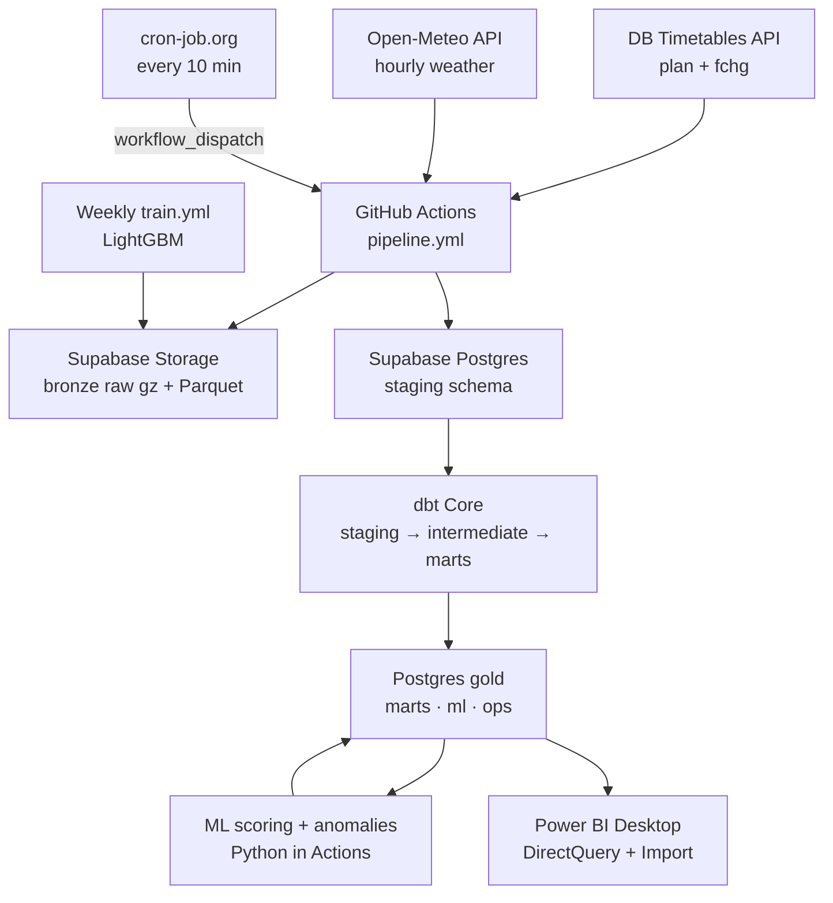

# DB Delay Intelligence — Complete Workflow & Step-by-Step Guide

**Stack:** DB Timetables API + Open-Meteo → GitHub Actions (triggered by cron-job.org) → Supabase (Postgres + Storage) → dbt Core → Python ML → Power BI Desktop
**Cost:** €0 per month · no credit card · no Azure
**Who this is for:** you, building it step by step (with or without Claude Code)

---

## Table of contents

1. [The big picture](#1-the-big-picture)
2. [Architecture & workflow](#2-architecture--workflow)
3. [Free-tier limits that shape the design](#3-free-tier-limits-that-shape-the-design)
4. [Step 0 — Accounts and local setup](#4-step-0--accounts-and-local-setup)
5. [Step 1 — Understand and source the data](#5-step-1--understand-and-source-the-data)
6. [Step 2 — Set up the database and storage](#6-step-2--set-up-the-database-and-storage)
7. [Step 3 — Build the ingestion code](#7-step-3--build-the-ingestion-code)
8. [Step 4 — Automate it: GitHub Actions + cron-job.org](#8-step-4--automate-it-github-actions--cron-joborg)
9. [Step 5 — Transform with dbt](#9-step-5--transform-with-dbt)
10. [Step 6 — AI layer](#10-step-6--ai-layer)
11. [Step 7 — Housekeeping and monitoring](#11-step-7--housekeeping-and-monitoring)
12. [Step 8 — Power BI dashboard](#12-step-8--power-bi-dashboard)
13. [Step 9 — Portfolio polish](#13-step-9--portfolio-polish)
14. [Timeline](#14-timeline)
15. [Troubleshooting](#15-troubleshooting)
16. [Glossary](#16-glossary)
17. [Sources](#17-sources)

---

## 1. The big picture

**What the system does:** every 10 minutes it collects live Deutsche Bahn data for 15 major stations, cleans and models it, predicts which departures in the next 2 hours will be late, flags unusual disruptions, and shows everything in Power BI.

**Questions the dashboard answers:**

- How punctual is each station and train type right now, compared with last week?
- Which departures in the next 2 hours are likely to leave 6+ minutes late?
- Is today unusual? Which stations have abnormal delays?
- Is the pipeline healthy? When was the last load, and did anything fail?

**The tools and why each one:**

| Phase | Tool | Why this tool | Cost |
|---|---|---|---|
| Sourcing | DB Timetables API | Official live DB data: plans, delays, cancellations, platforms | €0 |
| Sourcing | Open-Meteo API | Free weather; no key needed | €0 |
| Scheduling | cron-job.org | Reliable free timer that starts the pipeline every 10 min | €0 |
| Compute | GitHub Actions (public repo) | Runs Python + dbt in the cloud; unlimited minutes for public repos | €0 |
| Raw storage | Supabase Storage | Bronze layer: short-term raw files + long-term Parquet history | €0 (1 GB) |
| Database | Supabase Postgres | Staging, models, predictions; Power BI connects here | €0 (500 MB) |
| Transform | dbt Core | SQL models, tests, documentation, lineage | €0 |
| AI | LightGBM, scikit-learn | Delay prediction + anomaly detection | €0 |
| Visualize | Power BI Desktop | Live dashboard with DirectQuery + auto page refresh | €0 |
| Code | GitHub + Claude Code (optional) | Version control, CI, AI-assisted building | €0 |

---

## 2. Architecture & workflow

### 2.1 Architecture diagram



### 2.2 What runs when

| When | Workflow | What happens |
|---|---|---|
| Every 10 min | `pipeline.yml` | Fetch changes → save raw → load staging → dbt build (live models) → every 3rd run: score predictions + anomalies |
| Once per hour (inside `pipeline.yml`) | same | Also fetches the plan for the next 2 hours and the weather |
| Daily 03:20 UTC | `daily.yml` | Export Parquet history, delete old rows and raw files, rebuild daily aggregates |
| Daily 20:00 UTC (21:00 Berlin in winter) | `daily.yml` | Optional LLM disruption summary |
| Weekly, Sunday 04:00 UTC | `train.yml` | Retrain the model; promote it only if it beats the baseline |
| On every pull request | `ci.yml` | Lint, unit tests, dbt build against a throwaway database |
| While you watch | Power BI | Automatic page refresh every 5 min on the live pages |

### 2.3 One 10-minute cycle, step by step

1. **:00** cron-job.org sends a request to GitHub's API → `pipeline.yml` starts.
2. **:01** Python calls `fchg` for 15 stations (~15 calls) → saves gzipped raw XML to Supabase Storage → parses → inserts only new change rows into `staging.stop_changes`.
3. **:01** If the last plan load is older than 50 min: fetch `plan` for the current + next hour, plus weather.
4. **:02** dbt checks source freshness, then builds the live models: `stg_*` → `int_*` → `fact_stop_event` (incremental) → tests.
5. **:03** On every 3rd run (every 30 min): Python scores departures in the next 2 hours → `ml.predictions`; anomaly check → `ml.alerts`.
6. **:03** The run is logged to `ops.ingestion_runs` / `ops.dbt_runs`. Any failure → GitHub emails you.
7. **within 5 min** Power BI auto page refresh shows the new data.

---

## 3. Free-tier limits that shape the design

Know these before building. Each design choice below exists because of one of them.

| Limit | Value | Design response |
|---|---|---|
| DB API rate limit | 60 calls/min (Marketplace) | 15 stations, max 50 calls/min, 1 s spacing |
| DB API plan window | ~next 18 hours | Fetch the plan every hour for the next 2 hours |
| Open-Meteo free use | non-commercial; < 10,000 calls/day | One multi-location call per hour (~24/day) |
| GitHub schedule trigger | can be delayed or dropped under load | Use cron-job.org as the main trigger; GitHub schedule only as a fallback |
| GitHub inactive repos | scheduled workflows pause after 60 days without activity | Commit regularly; cron-job.org triggers keep working |
| Supabase database | 500 MB | 7-day staging retention; 90-day fact detail; history moves to Parquet |
| Supabase file storage | 1 GB | Raw files kept 3 days only; long-term history as small daily Parquet |
| Supabase egress | 5 GB/month | Do the heavy work in SQL inside the database; score every 30 min, not every 10 |
| Supabase pause | after 7 days of inactivity | Writes every 10 min prevent it |
| Supabase direct host | IPv6-only | Always use the **Session pooler** connection |

> **Measure in week 1:** database size, storage size and egress (Supabase → Project → Usage). Adjust retention if needed.

---

## 4. Step 0 — Accounts and local setup

### 4.1 Accounts (all free, no card)

- [ ] **GitHub** — create a **public** repo `db-delay-intelligence`
- [ ] **DB API Marketplace** (developers.deutschebahn.com) — register → create an application → subscribe to **Timetables** (Free plan) → note the **Client ID** and **API key**
- [ ] **Supabase** — new project, region **EU Central (Frankfurt)**, strong DB password saved in a password manager
- [ ] **cron-job.org** — free account (used in Step 4)
- [ ] Optional: **Databricks Free Edition** (weekly ML experiments), an **LLM API key** (daily summary)

### 4.2 Local tools

- Python 3.11, Git, VS Code (+ Python and dbt extensions)
- Power BI Desktop (Windows; from the Microsoft Store)
- Optional: Claude Code, plus the dbt agent skills (see 9.1)

Your 8 GB laptop is enough: all heavy work runs in GitHub Actions and Supabase.

### 4.3 Repository structure

```text
db-delay-intelligence/
├── .github/workflows/        # pipeline.yml, daily.yml, train.yml, ci.yml
├── ingestion/                # Python: API clients, parser, loader, run.py
│   └── tests/fixtures/       # real API responses (Step 1)
├── sql/                      # DDL for schemas, tables, roles
├── transform/                # dbt project
├── ml/                       # features, score, train, anomalies, summary, housekeeping
├── powerbi/                  # .pbip project, measures.md
├── docs/                     # this guide, api_notes.md, PROGRESS.md
├── requirements.txt
├── .env.example              # variable names only, never values
└── README.md
```

### 4.4 Environment variables

Create `.env` locally (it's in `.gitignore`). Add the same names as **GitHub → Settings → Secrets and variables → Actions → New repository secret**.

```dotenv
DB_CLIENT_ID=
DB_API_KEY=
DB_BASE_URL=https://apis.deutschebahn.com/db-api-marketplace/apis/timetables/v1
PG_HOST=            # Session pooler host from Supabase → Connect
PG_PORT=5432
PG_DB=postgres
PG_USER=            # pooler format: postgres.<project-ref>
PG_PASSWORD=
SUPABASE_URL=       # https://<project-ref>.supabase.co
SUPABASE_SERVICE_KEY=   # service_role key — secret, server-side only
LLM_API_KEY=        # optional
```

> ⚠️ Verify `DB_BASE_URL` and the header names (usually `DB-Client-Id` and `DB-Api-Key`) on the Timetables page in the DB API Marketplace. Never commit `.env`. The `service_role` key bypasses security, so it lives only in GitHub Secrets and your local `.env`.

---

## 5. Step 1 — Understand and source the data

### 5.1 How the DB Timetables API works

| Endpoint | Returns | How you use it |
|---|---|---|
| `/station/{pattern}` | Station search → EVA number | Once, to build the station list |
| `/plan/{eva}/{yyMMdd}/{HH}` | Planned stops for one station and one hour | Hourly, for the current + next hour |
| `/fchg/{eva}` | All known changes for the day (delays, cancellations, platforms) | Every 10 min |
| `/rchg/{eva}` | Only changes from the last 2 minutes | Not used (would need polling every 2 min) |

**How to read the XML:**

- `<s id="...">` = one **stop** (one train at one station). The `id` links plan and changes.
- `<tl c="ICE" n="1234">` = train category and number.
- `<ar>` arrival, `<dp>` departure, with attributes: `pt` planned time, `ct` changed (actual/forecast) time, `pp`/`cp` planned/changed platform, `l` line (e.g. `RE1`), `ppth` route, `cs="c"` cancelled.
- Times look like `2611051405` = `yyMMddHHmm` in **German local time**.

**Key idea:** the plan says what should happen; changes say what is happening. Join them on `stop_id`. The latest change before departure gives the actual delay. No change at all → the train is assumed on time.

### 5.2 Explore and save real responses

Write `ingestion/explore.py` and run it locally once. It should:

1. Look up these 15 stations via `/station/{name}` and save `eva,station_name,lat,lon,is_berlin` to `transform/seeds/stations.csv`: Berlin Hbf, Berlin Südkreuz, Berlin Ostbahnhof, Berlin Gesundbrunnen, Berlin-Spandau, Hamburg Hbf, Hannover Hbf, Leipzig Hbf, Frankfurt(Main)Hbf, Köln Hbf, Düsseldorf Hbf, München Hbf, Nürnberg Hbf, Stuttgart Hbf, Dresden Hbf. (Berlin Hbf is EVA `8011160`.) If the API gives no coordinates, add them by hand from a map.
2. Save real `plan`, `fchg` and weather responses into `ingestion/tests/fixtures/`.
3. Write `docs/api_notes.md` listing every element and attribute you actually saw.

> **Why:** building the parser from real responses avoids most bugs. Never type EVA numbers or XML attribute names from memory.

### 5.3 Weather

One Open-Meteo call per hour for all 15 stations: pass comma-separated `latitude=` and `longitude=` lists and request hourly `temperature_2m,precipitation,snowfall,wind_gusts_10m`. Credit "Weather data by Open-Meteo.com" in the dashboard.

---

## 6. Step 2 — Set up the database and storage

### 6.1 Get the connection details

Supabase → your project → **Connect** → copy the **Session pooler** connection (host, port 5432, user `postgres.<project-ref>`). GitHub Actions and Power BI both use this.

### 6.2 Create schemas and tables

Run this in the **Supabase SQL Editor** (save it as `sql/010_setup.sql` in the repo):

```sql
create schema if not exists staging;
create schema if not exists intermediate;
create schema if not exists marts;
create schema if not exists ml;
create schema if not exists ops;

create table if not exists staging.plan_stops (
  stop_id          text primary key,
  eva              int  not null,
  train_category   text,
  train_number     text,
  line             text,
  planned_arr      timestamptz,
  planned_dep      timestamptz,
  planned_platform text,
  route_ppth       text,
  fetched_at       timestamptz not null,
  loaded_at        timestamptz not null default now()
);

create table if not exists staging.stop_changes (
  stop_id          text not null,
  eva              int  not null,
  changed_arr      timestamptz,
  changed_dep      timestamptz,
  changed_platform text,
  is_cancelled     boolean not null default false,
  content_hash     text not null,
  fetched_at       timestamptz not null,
  loaded_at        timestamptz not null default now(),
  primary key (stop_id, content_hash)
);

create table if not exists staging.weather_hourly (
  eva              int not null,
  observed_hour    timestamptz not null,
  temperature_c    numeric,
  precipitation_mm numeric,
  snowfall_cm      numeric,
  wind_gust_kmh    numeric,
  fetched_at       timestamptz not null,
  loaded_at        timestamptz not null default now(),
  primary key (eva, observed_hour)
);

create table if not exists ops.ingestion_runs (
  run_id        uuid primary key default gen_random_uuid(),
  job           text not null,
  started_at    timestamptz not null,
  finished_at   timestamptz,
  api_calls     int,
  rows_inserted int,
  status        text,
  error         text
);

create index if not exists ix_changes_loaded on staging.stop_changes (loaded_at);
create index if not exists ix_plan_loaded    on staging.plan_stops (loaded_at);
```

### 6.3 Read-only user for Power BI

```sql
create role powerbi_reader login password 'CHANGE-ME-strong-password';
grant usage on schema marts, ml, ops to powerbi_reader;
grant select on all tables in schema marts, ml, ops to powerbi_reader;
alter default privileges in schema marts grant select on tables to powerbi_reader;
alter default privileges in schema ml    grant select on tables to powerbi_reader;
alter default privileges in schema ops   grant select on tables to powerbi_reader;
```

Through the pooler, this user logs in as `powerbi_reader.<project-ref>`.

### 6.4 Storage buckets

Supabase → Storage → create two **private** buckets:

- `bronze` — raw gzipped API responses (kept 3 days) and daily Parquet history (kept long-term)
- `ml` — model files and training metrics

---

## 7. Step 3 — Build the ingestion code

### 7.1 Modules and their jobs

| File | Job |
|---|---|
| `settings.py` | Reads environment variables in one place |
| `db_client.py` | Calls the DB API with headers, rate limit (≤ 50/min), retries on 429/5xx |
| `meteo_client.py` | One multi-location weather call |
| `parser.py` | XML → Python rows; converts times to UTC; computes `content_hash` |
| `storage.py` | Uploads gzipped raw files to the Supabase `bronze` bucket |
| `loader.py` | Inserts rows into Postgres in one transaction; logs to `ops.ingestion_runs` |
| `run.py` | Entry point: `python -m ingestion.run changes` / `python -m ingestion.run hourly` |

### 7.2 Time conversion

The most important function in the project:

```python
from datetime import datetime
from zoneinfo import ZoneInfo

BERLIN = ZoneInfo("Europe/Berlin")
UTC = ZoneInfo("UTC")

def parse_db_time(value: str | None) -> datetime | None:
    """'2611051405' (yyMMddHHmm, German local time) -> aware UTC datetime."""
    if not value:
        return None
    local = datetime.strptime(value, "%y%m%d%H%M").replace(tzinfo=BERLIN)
    return local.astimezone(UTC)
```

> Store **everything in UTC** in the database; convert to Berlin time only in reports. Daylight-saving weekends test this. On the night clocks go back, 02:00–03:00 happens twice, and Python picks the first occurrence. Write a test for it.

### 7.3 Parse a plan response

```python
from lxml import etree

def _attr(el, name):
    return el.get(name) if el is not None else None

def parse_plan(xml_bytes: bytes, eva: int, fetched_at):
    root = etree.fromstring(xml_bytes)
    for s in root.findall("s"):
        tl, ar, dp = s.find("tl"), s.find("ar"), s.find("dp")
        event = dp if dp is not None else ar
        yield {
            "stop_id": s.get("id"),
            "eva": eva,
            "train_category": _attr(tl, "c"),
            "train_number": _attr(tl, "n"),
            "line": _attr(event, "l"),
            "planned_arr": parse_db_time(_attr(ar, "pt")),
            "planned_dep": parse_db_time(_attr(dp, "pt")),
            "planned_platform": _attr(event, "pp"),
            "route_ppth": _attr(event, "ppth"),
            "fetched_at": fetched_at,
        }
```

`parse_changes` follows the same pattern, reading `ct`, `cp` and `cs` from `<ar>`/`<dp>`. Then build `content_hash = sha256(stop_id|changed_arr|changed_dep|changed_platform|is_cancelled)`, so an unchanged train isn't stored again every 10 minutes.

### 7.4 Idempotent loading

```python
INSERT_CHANGES = """
insert into staging.stop_changes
  (stop_id, eva, changed_arr, changed_dep, changed_platform, is_cancelled, content_hash, fetched_at)
values (%(stop_id)s, %(eva)s, %(changed_arr)s, %(changed_dep)s, %(changed_platform)s,
        %(is_cancelled)s, %(content_hash)s, %(fetched_at)s)
on conflict (stop_id, content_hash) do nothing
"""

UPSERT_PLAN = """
insert into staging.plan_stops (stop_id, eva, train_category, train_number, line,
  planned_arr, planned_dep, planned_platform, route_ppth, fetched_at)
values (%(stop_id)s, %(eva)s, %(train_category)s, %(train_number)s, %(line)s,
  %(planned_arr)s, %(planned_dep)s, %(planned_platform)s, %(route_ppth)s, %(fetched_at)s)
on conflict (stop_id) do update set
  planned_arr = excluded.planned_arr, planned_dep = excluded.planned_dep,
  planned_platform = excluded.planned_platform, fetched_at = excluded.fetched_at,
  loaded_at = now()
"""
```

> **Idempotent** means running the same load twice gives the same result. This matters because the pipeline sometimes runs twice (fallback trigger, retries).

### 7.5 The "hourly" check

Don't rely on exact clock times, because triggers can be late. `run.py hourly` first asks the database:

```sql
select coalesce(max(finished_at) < now() - interval '50 minutes', true) as due
from ops.ingestion_runs where job = 'plan' and status = 'success';
```

It fetches the plan and weather only if `due` is true.

### 7.6 Raw file paths in the bronze bucket

```text
bronze/db/fchg/date=2026-11-05/eva=8011160/140012.xml.gz
bronze/db/plan/date=2026-11-05/eva=8011160/140512_h14.xml.gz
bronze/meteo/date=2026-11-05/140513.json.gz
```

### 7.7 Tests (run locally with `pytest`)

- Parser on real fixtures: correct row count, a cancellation, a platform change
- `parse_db_time` normal, on the DST switch (25 Oct 2026), and with `None`
- Hash stability: the same input always gives the same hash
- Loader: insert the same rows twice → no duplicates (local Postgres in Docker, or the CI service container)

**Done when:** `python -m ingestion.run changes` works locally and you see rows in Supabase → Table editor → `staging.stop_changes`.

---

## 8. Step 4 — Automate it: GitHub Actions + cron-job.org

### 8.1 Pipeline workflow

`.github/workflows/pipeline.yml`:

```yaml
name: pipeline

on:
  workflow_dispatch:            # main trigger: cron-job.org calls this every 10 min
  schedule:
    - cron: "7,37 * * * *"      # fallback only, in case the external trigger fails

concurrency:
  group: pipeline
  cancel-in-progress: false     # never run two pipelines at the same time

jobs:
  run:
    runs-on: ubuntu-latest
    timeout-minutes: 8
    env:
      DB_CLIENT_ID: ${{ secrets.DB_CLIENT_ID }}
      DB_API_KEY: ${{ secrets.DB_API_KEY }}
      DB_BASE_URL: ${{ secrets.DB_BASE_URL }}
      PG_HOST: ${{ secrets.PG_HOST }}
      PG_PORT: ${{ secrets.PG_PORT }}
      PG_DB: ${{ secrets.PG_DB }}
      PG_USER: ${{ secrets.PG_USER }}
      PG_PASSWORD: ${{ secrets.PG_PASSWORD }}
      SUPABASE_URL: ${{ secrets.SUPABASE_URL }}
      SUPABASE_SERVICE_KEY: ${{ secrets.SUPABASE_SERVICE_KEY }}
      DBT_PROFILES_DIR: ${{ github.workspace }}/transform
    steps:
      - uses: actions/checkout@v4
      - uses: actions/setup-python@v5
        with:
          python-version: "3.11"
          cache: pip
      - run: pip install -r requirements.txt

      - name: Ingest changes (every run)
        run: python -m ingestion.run changes

      - name: Ingest plan + weather (if due)
        run: python -m ingestion.run hourly

      - name: dbt build (live models)
        working-directory: transform
        run: |
          dbt deps
          dbt source freshness
          dbt build --selector live

      - name: Score + anomalies (if due, every ~30 min)
        run: python -m ml.score && python -m ml.anomalies
```

How it behaves:

- If any step fails, the later steps are skipped and GitHub emails you (Settings → Notifications → Actions).
- `ml.score` checks itself whether 30 minutes have passed since the last scoring, using the same pattern as 7.5. This keeps Supabase egress low.
- If no model exists yet (first weeks), `ml.score` only writes the feature log and exits cleanly.

### 8.2 External trigger on cron-job.org

1. GitHub → Settings → Developer settings → **Fine-grained personal access token**: repository access = only `db-delay-intelligence`; permission **Actions: Read and write**; expiry 90 days (set a calendar reminder to renew).
2. cron-job.org → Create cronjob:
   - URL: `https://api.github.com/repos/<your-user>/db-delay-intelligence/actions/workflows/pipeline.yml/dispatches`
   - Schedule: every 10 minutes
   - Advanced → Request method: **POST**
   - Headers: `Accept: application/vnd.github+json`, `Authorization: Bearer <your token>`, `X-GitHub-Api-Version: 2022-11-28`
   - Body: `{"ref":"main"}`
3. Save → "Test run" → a successful call returns **HTTP 204**, and a new run appears in GitHub → Actions.

### 8.3 Let it collect

**Gate:** 24 hours with no failed runs, rows growing in `staging`, and no duplicate `stop_id` in `staging.plan_stops`. Then keep it running while you build the rest. The model needs 2–3 weeks of history.

---

## 9. Step 5 — Transform with dbt

### 9.1 Optional: dbt agent skills for Claude Code

If you build with Claude Code, install these skills in the repo:

```bash
npx -y skills add dbt-labs/dbt-agent-skills --skill using-dbt-for-analytics-engineering --agent claude-code
npx -y skills add dbt-labs/dbt-agent-skills --skill adding-dbt-unit-test --agent claude-code
npx -y skills add dbt-labs/dbt-agent-skills --skill running-dbt-commands --agent claude-code
npx -y skills add dbt-labs/dbt-agent-skills --skill fetching-dbt-docs --agent claude-code
npx -y skills add dbt-labs/dbt-agent-skills --skill working-with-dbt-mesh --agent claude-code
npx -y skills add dbt-labs/dbt-agent-skills --skill creating-mermaid-dbt-dag --agent claude-code
```

Use: models → `using-dbt-for-analytics-engineering`; logic tests → `adding-dbt-unit-test`; CLI → `running-dbt-commands`; config questions → `fetching-dbt-docs`; contracts on Power BI tables → `working-with-dbt-mesh`; README lineage → `creating-mermaid-dbt-dag`. Skip the Semantic Layer, dbt State, Cloud-job and migration skills: they need dbt Cloud or don't apply.

### 9.2 Project setup

`requirements.txt` includes `dbt-postgres` (latest 1.x; unit tests need 1.8 or newer). Create the project with `dbt init db_delay` inside `transform/`, then write `transform/profiles.yml`:

```yaml
db_delay:
  target: prod
  outputs:
    prod:
      type: postgres
      host: "{{ env_var('PG_HOST') }}"
      port: "{{ env_var('PG_PORT') | int }}"
      user: "{{ env_var('PG_USER') }}"
      password: "{{ env_var('PG_PASSWORD') }}"
      dbname: "{{ env_var('PG_DB') }}"
      schema: intermediate
      sslmode: require
      threads: 4
```

In `dbt_project.yml`, set materializations per folder: staging = view, intermediate = view, marts = table (the fact overrides to incremental). Add a `generate_schema_name` macro so models land exactly in `intermediate` / `marts` / `ml`. Add the `live` and `daily` tags. Put `dbt-labs/dbt_utils` in `packages.yml`.

### 9.3 The model layers

```text
sources (staging.*)
   └── stg_db__plan_stops, stg_db__stop_changes, stg_meteo__weather_hourly   (rename, cast)
         └── int_stop_latest_change                                          (latest change before departure)
               └── int_stop_enriched                                         (delays, flags)
                     ├── fact_stop_event          (incremental, grain = stop_id)
                     ├── v_today_stop_event       (view for Power BI DirectQuery)
                     ├── agg_station_hour         (daily, for history pages)
                     └── ml_features_upcoming     (features for scoring, built in SQL)
dims: dim_station (seed), dim_train, dim_date, dim_hour · fact_weather_hourly
```

### 9.4 Sources with freshness

`models/staging/_sources.yml`:

```yaml
version: 2
sources:
  - name: db_raw
    schema: staging
    loaded_at_field: loaded_at
    freshness:
      warn_after: {count: 20, period: minute}
      error_after: {count: 60, period: minute}
    tables:
      - name: plan_stops
      - name: stop_changes
      - name: weather_hourly
        freshness:
          warn_after: {count: 90, period: minute}
          error_after: {count: 180, period: minute}
```

> Check the exact freshness syntax for your dbt version with the `fetching-dbt-docs` skill or the dbt docs. Newer versions also accept these settings under `config:`.

### 9.5 The core logic

`int_stop_latest_change.sql`:

```sql
with changes as (
    select * from {{ ref('stg_db__stop_changes') }}
),
plan as (
    select stop_id, coalesce(planned_dep, planned_arr) as planned_event
    from {{ ref('stg_db__plan_stops') }}
),
ranked as (
    select
        c.*,
        row_number() over (partition by c.stop_id order by c.fetched_at desc) as rn
    from changes c
    join plan p using (stop_id)
    -- ignore changes fetched long after the train left
    where c.fetched_at <= coalesce(c.changed_dep, c.changed_arr, p.planned_event) + interval '15 minutes'
)
select * from ranked where rn = 1
```

`int_stop_enriched.sql`:

```sql
select
    p.stop_id,
    p.eva,
    p.train_category,
    p.train_number,
    p.line,
    p.planned_arr,
    p.planned_dep,
    coalesce(c.changed_arr, p.planned_arr) as actual_arr,
    coalesce(c.changed_dep, p.planned_dep) as actual_dep,
    (c.stop_id is not null)                as has_realtime,
    coalesce(c.is_cancelled, false)        as is_cancelled,
    (c.changed_platform is not null and c.changed_platform <> p.planned_platform) as platform_changed,
    round(extract(epoch from (coalesce(c.changed_dep, p.planned_dep) - p.planned_dep)) / 60)::int as dep_delay_min,
    round(extract(epoch from (coalesce(c.changed_arr, p.planned_arr) - p.planned_arr)) / 60)::int as arr_delay_min,
    greatest(p.loaded_at, coalesce(c.loaded_at, p.loaded_at)) as loaded_at
from {{ ref('stg_db__plan_stops') }} p
left join {{ ref('int_stop_latest_change') }} c using (stop_id)
```

Then add the flags: `is_punctual = not is_cancelled and coalesce(dep_delay_min, arr_delay_min) < 6` (DB's definition: under 6 minutes is punctual), a `delay_band`, and `service_date` in Berlin time.

### 9.6 Incremental fact

`fact_stop_event.sql` (header):

```sql
{{ config(
    materialized='incremental',
    incremental_strategy='delete+insert',
    unique_key='stop_id',
    tags=['live']
) }}

select * from {{ ref('int_stop_enriched') }}

where loaded_at > (select max(loaded_at) - interval '3 hours' from {{ this }})

```

> **Why `delete+insert`:** it's a widely supported incremental strategy on Postgres. The 3-hour lookback catches late changes to trains already in the table.

### 9.7 Tests that make it trustworthy

- **Unit tests** (YAML, mocked inputs) for `int_stop_latest_change` and `int_stop_enriched`:
    1. the latest change before departure wins
    2. a change fetched long after departure is ignored
    3. no change → delay 0 and `has_realtime = false`
    4. cancellation → not punctual
    5. 5 minutes late = punctual; 6 minutes = not punctual
    6. a stop on the DST night computes the correct delay
- **Data tests:** `unique` + `not_null` on `stop_id`; `relationships` from facts to dims; `accepted_values` for train category (take the list from real data with `dbt show`); a custom test that delays stay between −60 and 1,440 minutes.
- **Contracts** (`contract: {enforced: true}`) on everything Power BI reads, so a column change can't silently break the dashboard.
- **Exposure:** declare the Power BI dashboard in `exposures.yml`, so it appears in the lineage.

### 9.8 Selectors

`selectors.yml`: `live` = `tag:live` (used every 10 min); `daily` = `tag:daily` (aggregates, used once a day).

**Done when:** `dbt build` is green locally and inside `pipeline.yml`; `marts.fact_stop_event` grows every 10 minutes.

---

## 10. Step 6 — AI layer

### 10.1 Feature log (turn on in week 1)

`ml_features_upcoming` (a dbt view) computes features in SQL for departures in the next 2 hours:

- **Train:** category, line, minutes to departure, current reported delay
- **Network:** average delay at this station in the last 30 min; cancellations in the last hour; the same train's delay at an upstream tracked station
- **Calendar:** hour, weekday, holiday
- **Weather:** precipitation, snow, wind gusts, temperature

`ml/score.py` reads this view (small result → low egress). Each stop's features are logged **once**, on the first scoring run 30–60 minutes before departure, into `ml.feature_log` (typed columns, not JSON, to save space).

> **No leakage:** the model only learns from what was known at prediction time, because training uses the logged features rather than features recomputed later.

### 10.2 Train weekly

`.github/workflows/train.yml` (Sunday 04:00 UTC + manual) runs `ml/train.py`:

1. Load `ml.feature_log` joined to final actual delays (trains that left 30+ minutes ago).
2. Time split: last 7 days = test set.
3. **Baseline:** median delay per station × hour × train category.
4. Train a LightGBM regressor (delay minutes) and classifier (probability of 6+ minutes late).
5. Metrics: MAE vs the baseline MAE; precision, recall and ROC-AUC for the classifier.
6. **Promote only if MAE beats the baseline** → upload to Supabase Storage `ml/champion/` and write the metrics to `ml.model_runs`.

### 10.3 Score

Every ~30 minutes, `ml/score.py` loads the champion model and writes one row per upcoming stop to `ml.predictions` (`stop_id`, `scored_at`, `pred_delay_min`, `p_late`, `model_version`). It upserts, so each stop keeps only its latest prediction.

A dbt model `ml_prediction_eval` joins predictions to actual delays → MAE by day, which feeds the Model quality page.

### 10.4 Anomalies

`ml/anomalies.py` compares each station's current-hour average delay and cancellation rate with the same station, weekday and hour over the past 4 weeks, using a robust z-score (median and MAD). A score of 3 or more → `ml.alerts`. It skips until 3 weeks of history exist.

### 10.5 Optional: LLM daily summary

`ml/summary.py` (daily): send today's **aggregates only** (worst stations, alerts, weather) to any LLM API → a 5-sentence summary in English and German → `ml.daily_summary`. If `LLM_API_KEY` is empty, it exits cleanly.

### 10.6 Optional: Databricks Free Edition

Use it for a weekly EDA or experiment notebook, which adds Databricks to your CV. Free Edition limits outbound internet to trusted domains (LinkedIn verification can unlock more). If it can't reach Supabase, download a Parquet export from Storage and upload it to the workspace.

---

## 11. Step 7 — Housekeeping and monitoring

`.github/workflows/daily.yml` (03:20 UTC):

| Task | Why |
|---|---|
| Export yesterday's `fact_stop_event` + `feature_log` rows to Parquet in the `bronze/history/` bucket | Long-term history at a fraction of the size |
| Delete `staging` rows older than 7 days | Stay under 500 MB |
| Delete `fact_stop_event` detail older than 90 days (history stays in Parquet + `agg_station_hour`) | Stay under 500 MB |
| Delete raw `.xml.gz` files older than 3 days | Stay under 1 GB of storage |
| `dbt build --selector daily` | Rebuild aggregates |
| Write sizes (database MB, storage MB) to `ops.platform_usage` | See limits coming on the Pipeline health page |

**Monitoring checklist:**

- GitHub emails on failed runs (default on)
- The cron-job.org dashboard shows failed triggers
- `ops.ingestion_runs` and `ops.dbt_runs` → Pipeline health page in Power BI
- Weekly look at Supabase → Usage: database size, storage, egress

**CI** (`.github/workflows/ci.yml` on pull requests): ruff lint → pytest → a Postgres service container → run `sql/*.sql` → `dbt build`. A broken change can't reach `main`.

---

## 12. Step 8 — Power BI dashboard

### 12.1 Connect

1. Power BI Desktop → Get data → **PostgreSQL database**
2. Server: `<session-pooler-host>:5432` · Database: `postgres`
3. Credentials: Database → user `powerbi_reader.<project-ref>`, your password
4. If you get a certificate error, see Troubleshooting

### 12.2 Data model (composite)

| Table | Mode | Why |
|---|---|---|
| `marts.v_today_stop_event` | DirectQuery | Must be live |
| `ml.predictions`, `ml.alerts`, `ops.ingestion_runs` | DirectQuery | Must be live |
| `marts.agg_station_hour`, `ml.prediction_eval` | Import | History; fast |
| `marts.dim_station`, `dim_train`, `dim_date`, `dim_hour` | Import (Dual if offered) | Small, shared filters |

Relationships: facts → dims (many-to-one, single direction). Mark `dim_date` as the date table.

### 12.3 Key DAX measures

```dax
Departures = COUNTROWS ( v_today_stop_event )

Departures Not Cancelled =
    CALCULATE ( [Departures], v_today_stop_event[is_cancelled] = FALSE () )

On-time Departures =
    CALCULATE ( [Departures], v_today_stop_event[is_punctual] = TRUE () )

Punctuality % = DIVIDE ( [On-time Departures], [Departures Not Cancelled] )

Avg Delay (min) = AVERAGE ( v_today_stop_event[dep_delay_min] )

Cancellations =
    CALCULATE ( [Departures], v_today_stop_event[is_cancelled] = TRUE () )

History Punctuality % =
    DIVIDE ( SUM ( agg_station_hour[punctual_departures] ),
             SUM ( agg_station_hour[departures_not_cancelled] ) )

Predicted Late (next 2h) =
    CALCULATE ( COUNTROWS ( predictions ), predictions[p_late] >= 0.5 )

Minutes Since Last Load =
    DATEDIFF ( MAX ( ingestion_runs[finished_at] ), UTCNOW (), MINUTE )
```

### 12.4 The seven pages

| # | Page | Visuals |
|---|---|---|
| 1 | **Network now** | KPI cards (Punctuality %, Avg delay, Cancellations, Platform changes); station map (Azure Maps visual, lat/lon) colored by delay; punctuality by train category |
| 2 | **Station drill-down** | Station slicer; live departure table (planned vs actual, delay band); worst lines |
| 3 | **Next 2 hours (AI)** | Upcoming departures with predicted delay and risk band; filter for high risk |
| 4 | **Model quality** | Predicted vs actual scatter; MAE over time vs baseline |
| 5 | **Patterns** | Hour × weekday heatmap; category comparison; delay vs precipitation and wind |
| 6 | **Alerts & summary** | Alert table with severity; today's LLM summary as text |
| 7 | **Pipeline health** | Minutes since last load; rows per run; failed runs; database and storage usage |

### 12.5 Make it live

- Page → Format → **Page refresh** → On → every 5 minutes (works on DirectQuery pages)
- File → Save as → **Power BI project (.pbip)** into `powerbi/`, so the report lives in Git
- Add to the footer: "Data: Deutsche Bahn (CC BY 4.0) · Weather data by Open-Meteo.com"

### 12.6 Sharing

- Power BI Desktop is free. Publishing to the Power BI Service needs a Pro license, and connecting to Supabase from the Service would also need a gateway on an always-on machine.
- **Portfolio route (free):** screenshots + a 60-second screen recording of the live dashboard in the README.

---

## 13. Step 9 — Portfolio polish

README sections:

1. **Problem and outcome** (2 sentences + dashboard GIF)
2. **Architecture diagram** (the Mermaid diagram from 2.1)
3. **Data model** (dbt lineage; Mermaid DAG)
4. **Engineering decisions:** idempotent loads, content-hash dedupe, UTC + DST handling, point-in-time features, contracts, freshness checks, free-tier design
5. **Model results:** MAE vs baseline, with a chart
6. **Cost:** €0 per month, with the limits table
7. **How to run it** (setup steps)
8. **What I'd do next:** move it to Azure Functions / Fabric Real-Time Intelligence, or Airflow

Interview story in one line: *"A continuously updating pipeline on live DB data. Polling, bronze/silver/gold, tested dbt models, a leakage-free delay model that beats a baseline, served live to Power BI for €0."*

---

## 14. Timeline

| When | Steps | Gate |
|---|---|---|
| Days 1–3 | Step 0–4: accounts, sourcing, DB setup, ingestion, automation | 24 h of clean data |
| Week 1–2 | Step 5: dbt models, tests, contracts; turn on the feature log | `dbt build` green in the pipeline |
| Week 2 | Step 8 (pages 1, 2, 7) + Step 7 housekeeping, CI | Live dashboard working |
| Week 3 | Step 6: baseline, training, scoring, anomalies | MAE beats baseline |
| Week 4 | Remaining pages, LLM summary, README, demo video | Ready for applications |

---

## 15. Troubleshooting

| Problem | Cause | Fix |
|---|---|---|
| Can't connect from GitHub Actions to Supabase | Direct host is IPv6-only | Use the **Session pooler** host and the `postgres.<ref>` user |
| `401/403` from DB API | Wrong key pair, or Timetables not subscribed | Check the app subscription in the Marketplace |
| `429` from DB API | Too many calls | Lower concurrency; keep ≤ 50/min |
| Delays off by exactly 60 min | Local time saved as UTC | Use `parse_db_time`; store UTC |
| Runs not starting | cron-job.org token expired, or schedule paused | Renew the PAT; check the cron-job.org history |
| Two runs at once | Fallback + external trigger | `concurrency: group: pipeline` (already in the YAML) |
| dbt freshness error | Ingestion failed or stopped | Check the Actions logs and `ops.ingestion_runs` |
| Duplicates in fact | Wrong unique key | `delete+insert` on `stop_id` |
| Power BI "certificate" or SSL error | Windows doesn't trust Supabase's CA | Download the CA certificate (Supabase → Database settings → SSL) and install it into Windows' Trusted Root store, then reconnect |
| Power BI slow on live pages | DirectQuery scanning history | Use `v_today_stop_event` and add indexes |
| Database near 500 MB | Retention not running | Check `daily.yml`; drop S-Bahn categories |
| Egress near 5 GB | Too much data pulled to Python or Power BI | Score less often; aggregate in SQL; Import for history |

---

## 16. Glossary

- **EVA number** — DB's unique station ID (Berlin Hbf = 8011160).
- **Bronze / silver / gold** — raw data / cleaned data / business-ready models.
- **Idempotent** — re-running gives the same result, with no duplicates.
- **Incremental model** — dbt updates only new or changed rows instead of rebuilding everything.
- **Contract** — a dbt rule that fixes a model's columns and types, so consumers don't break.
- **Freshness** — how old the newest data is; dbt can fail when it's too old.
- **DirectQuery** — Power BI queries the database live. **Import** — Power BI keeps a copy.
- **Point-in-time features** — features built only from data that existed at prediction time.
- **MAE** — mean absolute error: the average number of minutes the prediction is off.

---

## 17. Sources

- DB API Marketplace — Timetables API: https://developers.deutschebahn.com/db-api-marketplace/apis/product/timetables
- Open-Meteo terms (free-use limits): https://open-meteo.com/en/terms
- Supabase free plan limits (summary): https://www.cloudzero.com/blog/supabase-pricing/
- GitHub Actions schedule delays and external triggers: https://github.com/orgs/community/discussions/209220
- GitHub Actions free-tier trade-offs: https://thebiggish.pages.dev/news/github-actions-2-000-free-minutes-can-replace-your-20-month-cron-server
- Databricks Free Edition limitations: https://docs.databricks.com/aws/en/getting-started/free-edition-limitations
- dbt agent skills: https://docs.getdbt.com/blog/dbt-agent-skills
- Power BI real-time streaming retirement: https://powerbi.microsoft.com/blog/announcing-the-retirement-of-real-time-streaming-in-power-bi
